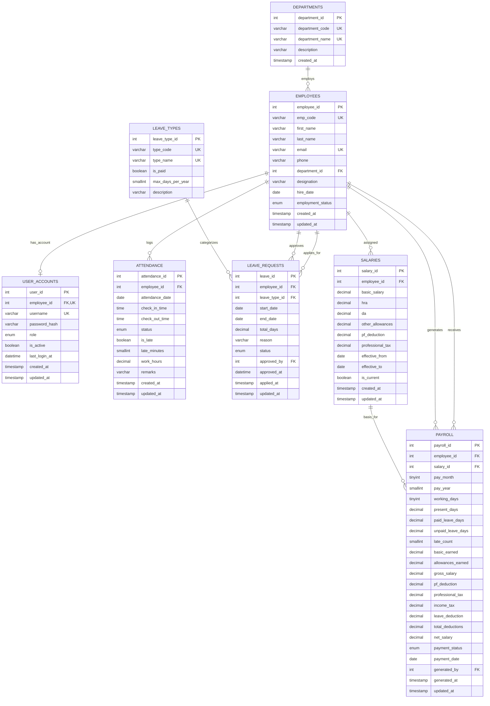

# Phase 1: Entity-Relationship Diagram & Cardinalities

## 1. Entities Overview

The database `payroll_attendance_db` models a mid-sized IT firm's Payroll and Attendance Management System using **5 mandatory core entities** and **3 normalized supporting entities**:

| # | Entity (SQL Table) | Category | Purpose |
|---|---|---|---|
| 1 | `departments` | Supporting (3NF) | Eliminates transitive dependencies for department details out of `employees`. |
| 2 | `employees` | **Mandatory Core** | Stores employee HR master attributes (`emp_code`, name, contact, designation, hire date, status). |
| 3 | `user_accounts` | Supporting (RBAC) | Separates login credentials and RBAC role (`HR_ADMIN`, `EMPLOYEE`) from HR master records. |
| 4 | `attendance` | **Mandatory Core** | Tracks daily check-in/out times, attendance status, late marks, and computed work hours. |
| 5 | `leave_types` | Supporting (3NF) | Normalizes paid/unpaid rules and annual leave entitlements out of `leave_requests`. |
| 6 | `leave_requests` | **Mandatory Core (Leave)** | Stores multiple leave applications per employee and approval workflow (`leave_requests` avoids the MySQL reserved keyword `LEAVE`). |
| 7 | `salaries` | **Mandatory Core** | Preserves versioned salary revision history (`effective_from`, `effective_to`, `is_current`). |
| 8 | `payroll` | **Mandatory Core** | Stores monthly payroll snapshots, attendance/leave summaries, tax, deductions, and net pay. |

## 2. Mermaid ER Diagram

> Raw Mermaid source is also saved in [ER_Diagram.mmd](ER_Diagram.mmd).

## 3. Relationships and Cardinalities

| ID | Relationship | Parent (1) | Child (N) | Cardinality | Participation | Business Rule |
|---|---|---|---|---|---|---|
| **R1** | Employs | `departments` | `employees` | **1 : N** | Mandatory on `employees` (1..1), Optional on `departments` (0..N) | Every employee belongs to one department; a department can have many employees. |
| **R2** | Has Account | `employees` | `user_accounts` | **1 : 0..1** | Mandatory on `user_accounts` (1..1), Optional on `employees` (0..1) | Each user account maps 1:1 to a unique employee (`employee_id` is `UNIQUE`). |
| **R3** | Logs | `employees` | `attendance` | **1 : N** | Mandatory on `attendance` (1..1), Optional on `employees` (0..N) | An employee logs at most one attendance row per `(employee_id, attendance_date)`. |
| **R4** | Applies For | `employees` | `leave_requests` | **1 : N** | Mandatory on `leave_requests` (1..1), Optional on `employees` (0..N) | An employee may submit multiple leave requests across time. |
| **R5** | Approves | `employees` | `leave_requests` | **1 : N** | Optional on `leave_requests` (0..1), Optional on `employees` (0..N) | `approved_by` references the HR/Admin employee who reviewed the request (`NULL` while `PENDING`). |
| **R6** | Categorizes | `leave_types` | `leave_requests` | **1 : N** | Mandatory on `leave_requests` (1..1), Optional on `leave_types` (0..N) | Every leave application specifies one leave category (`CL`, `SL`, `EL`, `LWP`). |
| **R7** | Assigned | `employees` | `salaries` | **1 : N** | Mandatory on `salaries` (1..1), Optional on `employees` (0..N) | Preserves salary revision history across `effective_from` dates per employee. |
| **R8** | Receives | `employees` | `payroll` | **1 : N** | Mandatory on `payroll` (1..1), Optional on `employees` (0..N) | Each employee receives at most one payroll record per `(pay_year, pay_month)`. |
| **R9** | Generates | `employees` | `payroll` | **1 : N** | Optional on `payroll` (0..1), Optional on `employees` (0..N) | `generated_by` tracks the HR/Admin employee who executed the payroll run. |
| **R10** | Basis For | `salaries` | `payroll` | **1 : N** | Mandatory on `payroll` (1..1), Optional on `salaries` (0..N) | Links each monthly payroll record to the exact salary structure active for that period. |
